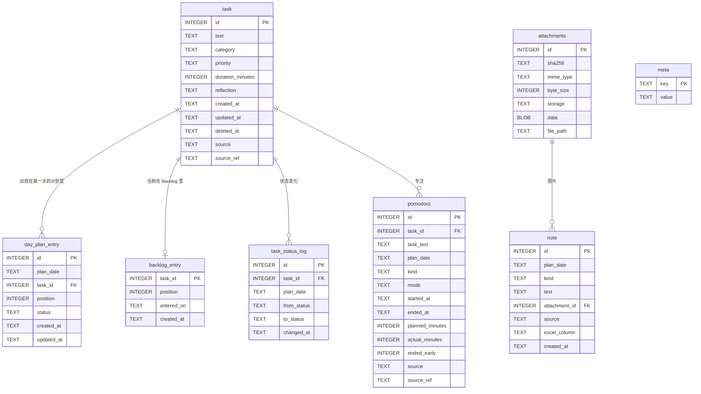
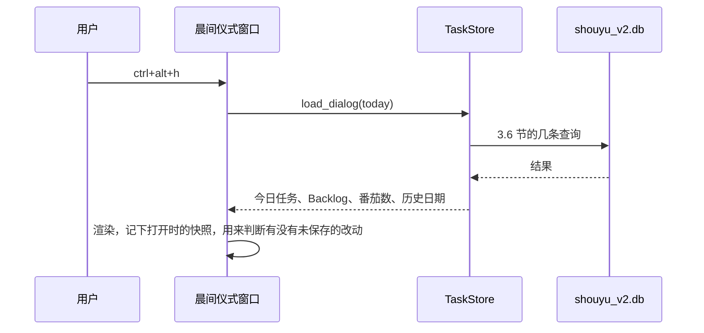
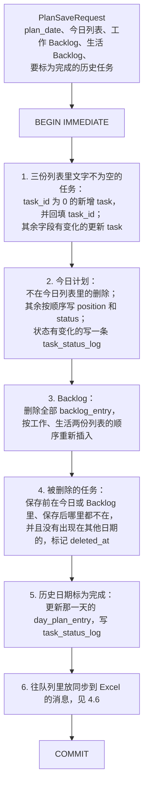
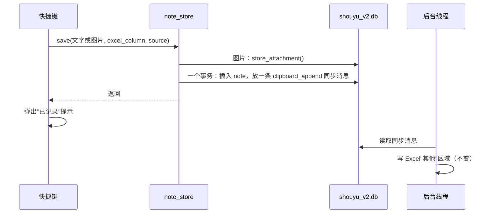
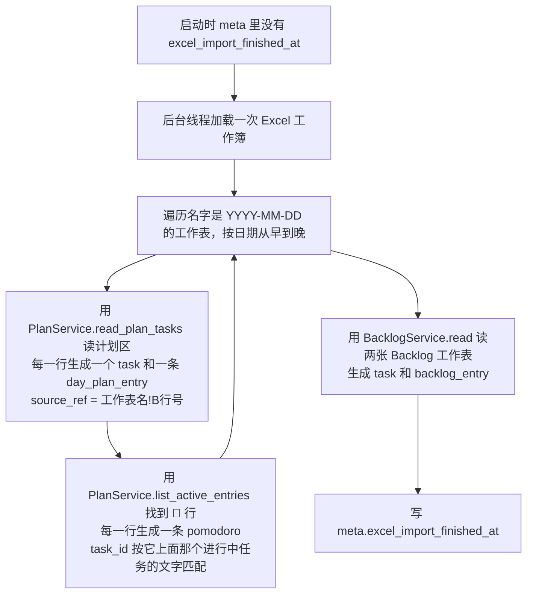

# 设计：今日任务、番茄、上一条记录改为以 SQLite 为主

> 状态：草稿 ｜ 更新：2026-10-31
>
> 需求：[requirements/planning/20261031-01-tasks-to-sqlite.md](../../requirements/planning/20261031-01-tasks-to-sqlite.md)（以下简称"需求"）。需求还是草稿，本设计按需求第 8 节已有的结论和"倾向"作为前提；如果结论不同，相应部分需要修改，受影响的地方在第 7 节列出。
>
> 依据：v2 分支起点 `ba6c474` 的代码。

## 1. 背景

需求涉及的功能，现在读写 Excel 的位置：

| 位置 | 读 | 写 |
|---|---|---|
| `shouyu/view/habit_dialog.py` | `refresh_plan_from_excel()` 读今日任务、两类 Backlog、今日番茄数；`_read_day_snapshot()` 读历史日期；`_select_latest_history_day()` 往前找 30 天 | `_enqueue_plan_save()` 把三份列表整份放进队列 |
| `shouyu/view/todo_panel.py` | `refresh_from_excel()` 读今日任务 | `_enqueue_plan_save()`，只包含今日任务 |
| `shouyu/service/pomodoro.py` | `_refresh_current_task_text_locked()` 读进行中的任务 | `_record_pomodoro_completion()` 直接调用 `KbExcel().append_detail()` 写一行 🍅 |
| `shouyu/action/shortcut.py` | `show_status()`（`alt+/`）调用 `KbExcel().move_column()`：加载工作簿，用 `current_anchor()` 找今天工作表最后的内容，弹出提示 | |
| `shouyu/action/shortcut.py` | | `_enqueue_clipboard_save()`：图片存进队列的 `attachments` 表，再放一条 `clipboard_append` 消息 |

实际写 Excel 的是 `shouyu/service/dispatch.py`，它调用 `plan.py` 的 `PlanService`、`BacklogService` 和 `excel.py` 的 `KbExcel`。

界面的工作方式：打开时读一次，之后在内存里编辑（包括撤销、重做），保存时把今日、工作 Backlog、生活 Backlog 三份列表整份交出去。本设计保留这个方式，只替换"读一次"和"整份交出去"这两端。

## 2. 目标

| 需求 | 设计上怎么满足 | 章节 |
|---|---|---|
| PLN-01、PLN-03、PLN-04 | 新增 `TaskStore`，晨间仪式窗口、今日任务面板只通过它读写 SQLite；不再有 Excel 方式的读取代码 | 4.1 |
| PLN-02 | 界面上的编辑逻辑不改，只改读和存这两端 | 4.1、4.3 |
| PLN-05 | 番茄钟通过 `TaskStore` 读当前任务、写 `pomodoro` 表 | 4.4 |
| PLN-06、PLN-07 | 直接在一个事务里写 SQLite，不经过队列，也不等 Excel | 4.3 |
| PLN-08 | 一次性导入，借用现有的 `PlanService`、`BacklogService` 解析 Excel，确保解读方式和现在一致 | 4.7 |
| PLN-09 | SQLite 写成功后，往现有队列里放同步消息，由现有的后台线程写 Excel | 4.6 |
| PLN-10 | v2 只用一个新的数据库文件 `shouyu_v2.db`，队列表和新的数据表都在里面 | 3.1 |
| PLN-11、PLN-12 | 任务和"任务在某一天的计划"分成两张表；状态变化单独记一张表 | 3 |
| PLN-13 | 打开窗口时只执行几条带索引的查询，不加载 Excel | 3.6 |
| PLN-14 | `alt+/` 查 `note` 表的最后一条 | 4.5 |
| PLN-15 | 保存剪贴板时先写 `note` 表，再放同步消息 | 4.5 |

## 3. 库表模型

### 3.1 存放位置

| 项 | 设计 |
|---|---|
| 文件 | v2 只用一个数据库文件 `shouyu_v2.db`，里面既有现有的队列表，也有本设计新增的表 |
| 配置 | 沿用现有配置项 `sqlite_db_path`，不新增配置项。v2 分支里 `message_queue.py` 的默认文件名 `DB_FILE_NAME` 从 `shouyu.db` 改为 `shouyu_v2.db`；`kb.ini` 里的 `sqlite_db_path` 改为指向 `shouyu_v2.db`（现在指向 v1 的 `shouyu.db`） |
| 为什么放在一个文件里 | 剪贴板的图片已经存在队列的 `attachments` 表里，放在同一个文件里，新的 `note` 表可以直接引用，不用把图片存两份；同步到 Excel 的消息也能直接引用新表里的记录 |
| 连接方式 | 和 `message_queue.py` 的 `_connect()` 一样：每次操作一个短连接，WAL 模式，`busy_timeout=5000`，`foreign_keys=ON` |

### 3.2 实体关系

图里实线框是本设计新增的表；`attachments` 是现有的队列表，被 `note` 引用。



任务部分的核心思路：**任务本身**（`task`）和**任务在某一天的计划里**（`day_plan_entry`）分开存。

| 现在的情况 | 在新模型里 |
|---|---|
| 一个任务今天没做完，明天结转过来 | 同一个 `task`，有两条 `day_plan_entry`：昨天那条是待办，今天那条是新的 |
| 历史日期"完成数/总数" | 那一天的 `day_plan_entry` 的状态统计，和当天实际情况一致，不受之后的变化影响 |
| 任务移进 Backlog | 删除今天的 `day_plan_entry`，新增一条 `backlog_entry`；`task` 不变 |
| 从 Backlog 拉到今天 | 删除 `backlog_entry`，新增今天的 `day_plan_entry` |

### 3.3 各表字段

#### `task`：任务本身

| 字段 | 类型 | 约束 | 说明 |
|---|---|---|---|
| `id` | INTEGER | 主键 | 任务身份（PLN-11） |
| `text` | TEXT | 非空 | 任务文字 |
| `category` | TEXT | 非空，`work` 或 `life`，默认 `work` | 对应 `TaskCategory` |
| `priority` | TEXT | 非空，`''`、`P1`、`P2`、`P3`，默认 `''` | 对应 `TaskPriority`，空字符串表示未设置 |
| `duration_minutes` | INTEGER | 非空，大于等于 0，默认 0 | 预估时长，0 表示未估时 |
| `reflection` | TEXT | 非空，默认 `''` | 完成后的反思 |
| `created_at`、`updated_at` | TEXT | 非空 | UTC 时间 |
| `deleted_at` | TEXT | 可空 | 用户删除任务时填写，不物理删除 |
| `source` | TEXT | 非空，`ui` 或 `excel_import`，默认 `ui` | 数据来源 |
| `source_ref` | TEXT | 可空 | 导入时记下来自 Excel 的哪个位置，比如 `2026-10-30!B5`、`backlog-work!A3`，用于防止重复导入 |

#### `day_plan_entry`：某一天的计划里有哪个任务

| 字段 | 类型 | 约束 | 说明 |
|---|---|---|---|
| `id` | INTEGER | 主键 | |
| `plan_date` | TEXT | 非空，`YYYY-MM-DD`，本地日期 | 对应 Excel 里的日期工作表 |
| `task_id` | INTEGER | 非空，外键指向 `task.id` | |
| `position` | INTEGER | 非空 | 当天列表里的顺序，从 0 开始 |
| `status` | TEXT | 非空，`pending`、`in_progress`、`suspended`、`done` | 这个任务**在这一天**的状态 |
| `created_at`、`updated_at` | TEXT | 非空 | UTC 时间 |

唯一约束：`(plan_date, task_id)`，同一天里同一个任务只出现一次。

#### `backlog_entry`：现在在 Backlog 里的任务

| 字段 | 类型 | 约束 | 说明 |
|---|---|---|---|
| `task_id` | INTEGER | 主键，外键指向 `task.id` | 一个任务最多在 Backlog 里出现一次 |
| `position` | INTEGER | 非空 | 在它所属的那个区里的顺序；属于哪个区看 `task.category` |
| `entered_on` | TEXT | 非空，`YYYY-MM-DD`，本地日期 | 进入 Backlog 的日期，用来显示"已搁置 N 天"，对应 `PlanTask.created_date` |
| `created_at` | TEXT | 非空 | UTC 时间 |

#### `task_status_log`：状态变化记录（PLN-12）

| 字段 | 类型 | 约束 | 说明 |
|---|---|---|---|
| `id` | INTEGER | 主键 | |
| `task_id` | INTEGER | 非空，外键 | |
| `plan_date` | TEXT | 非空 | 在哪一天的计划里发生的变化 |
| `from_status` | TEXT | 可空 | 第一次加入当天计划时为空 |
| `to_status` | TEXT | 非空 | |
| `changed_at` | TEXT | 非空 | UTC 时间。注意这是**保存的时间**，不是点击的时间（见 7.1） |

只追加，不修改、不删除。

#### `pomodoro`：番茄记录（PLN-05）

| 字段 | 类型 | 约束 | 说明 |
|---|---|---|---|
| `id` | INTEGER | 主键 | |
| `task_id` | INTEGER | 可空，外键 | 完成番茄时进行中的任务；没有或找不到时为空 |
| `task_text` | TEXT | 非空，默认 `''` | 完成时的任务名，任务以后改名或删除也能看到当时的名字 |
| `plan_date` | TEXT | 非空 | 本地日期，用来统计"某一天的番茄数" |
| `kind` | TEXT | 非空，`work` 或 `planning` | `planning` 是每天第一个规划番茄，不计入番茄数（需求 T-Q6） |
| `mode` | TEXT | 可空，`classic` 或 `deep` | 从 Excel 导入的记录为空 |
| `started_at`、`ended_at` | TEXT | 可空 | UTC 时间；从 Excel 导入、又解析不出时间的记录为空 |
| `planned_minutes` | INTEGER | 可空 | 配置的时长 |
| `actual_minutes` | INTEGER | 可空 | 实际专注分钟数 |
| `ended_early` | INTEGER | 非空，0 或 1，默认 0 | 是否点了"去休息"提前结束 |
| `source`、`source_ref` | TEXT | 同 `task` | |

#### `note`：剪贴板、截图、OCR 的记录（PLN-15）

| 字段 | 类型 | 约束 | 说明 |
|---|---|---|---|
| `id` | INTEGER | 主键 | `alt+/` 按它取最后一条 |
| `plan_date` | TEXT | 非空 | 本地日期 |
| `kind` | TEXT | 非空，`text` 或 `image` | |
| `text` | TEXT | 非空，默认 `''` | 文字内容；图片为空 |
| `attachment_id` | INTEGER | 可空，外键指向 `attachments.id` | 图片 |
| `source` | TEXT | 非空，`clipboard` 或 `ocr` | |
| `excel_column` | TEXT | 可空，`A` 或 `B` | 原样记下按 1 次还是 2 次（v1 的 A 列、B 列）。它在 v2 里表示什么还没定（总览 Q7），先原样保存，以后可以再解读 |
| `created_at` | TEXT | 非空 | UTC 时间 |

这张表只是剪贴板记录的最小版本。路线图 M1 要补的上下文（前台程序、窗口标题、网址、当时的任务）以后再加字段或加表。

#### `attachments`：现有的队列表，不改结构

见 `message_queue.py` 的 `init_db()`。`note` 直接引用它。

#### `meta`：数据库自身的信息

| key | value |
|---|---|
| `schema_version` | 新增表的结构版本，从 `1` 开始（对应 STO-11） |
| `excel_import_finished_at` | 导入完成的时间；没有这一行表示还没导入 |
| `excel_import_source` | 导入时使用的 Excel 路径 |

### 3.4 建表语句

```sql
CREATE TABLE IF NOT EXISTS meta (
    key   TEXT PRIMARY KEY,
    value TEXT NOT NULL
);

CREATE TABLE IF NOT EXISTS task (
    id               INTEGER PRIMARY KEY,
    text             TEXT    NOT NULL,
    category         TEXT    NOT NULL DEFAULT 'work' CHECK (category IN ('work', 'life')),
    priority         TEXT    NOT NULL DEFAULT ''     CHECK (priority IN ('', 'P1', 'P2', 'P3')),
    duration_minutes INTEGER NOT NULL DEFAULT 0      CHECK (duration_minutes >= 0),
    reflection       TEXT    NOT NULL DEFAULT '',
    created_at       TEXT    NOT NULL,
    updated_at       TEXT    NOT NULL,
    deleted_at       TEXT,
    source           TEXT    NOT NULL DEFAULT 'ui'   CHECK (source IN ('ui', 'excel_import')),
    source_ref       TEXT
);
-- Re-running the Excel import must not create duplicates.
CREATE UNIQUE INDEX IF NOT EXISTS ux_task_source_ref ON task(source, source_ref) WHERE source_ref IS NOT NULL;

CREATE TABLE IF NOT EXISTS day_plan_entry (
    id         INTEGER PRIMARY KEY,
    plan_date  TEXT    NOT NULL,
    task_id    INTEGER NOT NULL REFERENCES task(id),
    position   INTEGER NOT NULL,
    status     TEXT    NOT NULL CHECK (status IN ('pending', 'in_progress', 'suspended', 'done')),
    created_at TEXT    NOT NULL,
    updated_at TEXT    NOT NULL,
    UNIQUE (plan_date, task_id)
);
CREATE INDEX IF NOT EXISTS ix_day_plan_entry_date ON day_plan_entry(plan_date, position);
CREATE INDEX IF NOT EXISTS ix_day_plan_entry_task ON day_plan_entry(task_id);

CREATE TABLE IF NOT EXISTS backlog_entry (
    task_id    INTEGER PRIMARY KEY REFERENCES task(id),
    position   INTEGER NOT NULL,
    entered_on TEXT    NOT NULL,
    created_at TEXT    NOT NULL
);

CREATE TABLE IF NOT EXISTS task_status_log (
    id          INTEGER PRIMARY KEY,
    task_id     INTEGER NOT NULL REFERENCES task(id),
    plan_date   TEXT    NOT NULL,
    from_status TEXT,
    to_status   TEXT    NOT NULL,
    changed_at  TEXT    NOT NULL
);
CREATE INDEX IF NOT EXISTS ix_task_status_log_task ON task_status_log(task_id, changed_at);

CREATE TABLE IF NOT EXISTS pomodoro (
    id              INTEGER PRIMARY KEY,
    task_id         INTEGER REFERENCES task(id),
    task_text       TEXT    NOT NULL DEFAULT '',
    plan_date       TEXT    NOT NULL,
    kind            TEXT    NOT NULL DEFAULT 'work' CHECK (kind IN ('work', 'planning')),
    mode            TEXT    CHECK (mode IN ('classic', 'deep')),
    started_at      TEXT,
    ended_at        TEXT,
    planned_minutes INTEGER,
    actual_minutes  INTEGER,
    ended_early     INTEGER NOT NULL DEFAULT 0 CHECK (ended_early IN (0, 1)),
    source          TEXT    NOT NULL DEFAULT 'ui' CHECK (source IN ('ui', 'excel_import')),
    source_ref      TEXT
);
CREATE INDEX IF NOT EXISTS ix_pomodoro_date ON pomodoro(plan_date, kind);
CREATE UNIQUE INDEX IF NOT EXISTS ux_pomodoro_source_ref ON pomodoro(source, source_ref) WHERE source_ref IS NOT NULL;

-- `attachments` is created by message_queue.init_db(), which must run first.
CREATE TABLE IF NOT EXISTS note (
    id            INTEGER PRIMARY KEY,
    plan_date     TEXT    NOT NULL,
    kind          TEXT    NOT NULL CHECK (kind IN ('text', 'image')),
    text          TEXT    NOT NULL DEFAULT '',
    attachment_id INTEGER REFERENCES attachments(id),
    source        TEXT    NOT NULL CHECK (source IN ('clipboard', 'ocr')),
    excel_column  TEXT    CHECK (excel_column IN ('A', 'B')),
    created_at    TEXT    NOT NULL
);
CREATE INDEX IF NOT EXISTS ix_note_date ON note(plan_date);
```

### 3.5 约定

| 项 | 约定 | 理由 |
|---|---|---|
| 时间点 | TEXT，ISO-8601，UTC，精确到毫秒，以 `Z` 结尾，比如 `2026-10-31T01:30:00.123Z` | 和 `message_queue.py` 的 `_utcnow_iso()` 一致（`docs/excel-save-resilience.md` §8.3 已经定过） |
| 日期 | TEXT，`YYYY-MM-DD`，本地日期 | 和 Excel 工作表名、`AppState.today_str()` 一致，"今天"按本地时间算 |
| 枚举值 | 直接存 `TaskStatus`、`TaskPriority`、`TaskCategory` 的 `.value`，并用 CHECK 约束限制 | 和 `PlanTask.to_dict()` 一致，排查时一眼能看懂 |
| 顺序 | `position` 每次保存时按列表顺序重写为 0、1、2…… | 界面每次都整份保存，不需要支持在中间插入 |
| 删除 | `task` 只做标记删除（`deleted_at`）；`day_plan_entry`、`backlog_entry` 直接删除；`note` 这次不提供删除 | 任务可能出现在历史日期里，不能物理删除；计划和 Backlog 表示的是"现在在哪"，删掉就是移走了 |

### 3.6 需要的查询

打开晨间仪式窗口、按 `alt+/` 时，只执行下面这几条查询，都用得上索引或主键：

| 用途 | 查询 |
|---|---|
| 今日任务 | `SELECT ... FROM day_plan_entry e JOIN task t ON t.id = e.task_id WHERE e.plan_date = :today ORDER BY e.position` |
| 两类 Backlog | `SELECT ... FROM backlog_entry b JOIN task t ON t.id = b.task_id WHERE t.category = :category ORDER BY b.position` |
| 最近 30 天内有任务的一天 | `SELECT MAX(plan_date) FROM day_plan_entry WHERE plan_date < :today AND plan_date >= :today_minus_30` |
| 某一天的完成数和总数 | `SELECT COUNT(*), SUM(status = 'done') FROM day_plan_entry WHERE plan_date = :date` |
| 某一天的番茄数 | `SELECT COUNT(*) FROM pomodoro WHERE plan_date = :date AND kind = 'work'` |
| 当前进行中的任务 | `SELECT t.id, t.text FROM day_plan_entry e JOIN task t ON t.id = e.task_id WHERE e.plan_date = :today AND e.status = 'in_progress' LIMIT 1` |
| 上一条记录（`alt+/`） | `SELECT * FROM note ORDER BY id DESC LIMIT 1`（需求 T-Q9 选 A） |

按 5 年、每天十几个任务估算，`day_plan_entry` 大约 3 万行，以上查询都在毫秒级。

### 3.7 考虑过的其他方案

| 方案 | 为什么没选 |
|---|---|
| 只用一张 `task` 表，状态放在任务上，加一个"现在在哪"的字段 | 历史日期要显示"那一天"的状态，任务结转后状态会变，历史就不对了 |
| 结转时复制一个新任务，和 Excel 方式一样 | 认不出是同一个任务，做不到 PLN-11，以后也没法按任务关联（ASC-02）。代价是改名会影响历史显示（需求 T-Q5） |
| Backlog 不单独建表，在 `task` 上加 `backlog_position` 字段 | 可行。单独建表让"在 Backlog 里"这个状态和任务属性分开，表达更清楚，查询也一样简单 |
| 每次保存把今天的记录全部删掉再插入 | 会丢掉 `day_plan_entry.created_at`，也没法判断哪些状态变了、该记进 `task_status_log` |
| 新表放在另一个文件里，和队列分开 | 剪贴板图片要么存两份，要么跨文件引用；而且要多一个配置项 |
| `note` 另建一张附件表 | 现有 `attachments` 表的设计（图片内联、大文件落盘、sha256）已经够用，没必要再建一张 |

## 4. 读写流程

### 4.1 TaskStore

新增 `shouyu/service/task_store.py`，晨间仪式窗口、今日任务面板、番茄钟只通过它读写任务和番茄：

| 方法 | 谁调用 | 说明 |
|---|---|---|
| `load_dialog(today) -> DialogData` | 晨间仪式窗口打开时 | 一次返回今日任务、两类 Backlog、今日番茄数、最近一个有任务的历史日期及其内容 |
| `load_today(today) -> List[PlanTask]` | 今日任务面板 | |
| `load_day(date) -> DaySnapshot` | 晨间仪式窗口切换历史日期时 | 返回当天的未完成任务、完成数、总数、番茄数 |
| `save_plan(request: PlanSaveRequest)` | 两个窗口保存时 | 见 4.3 |
| `current_in_progress(today) -> Optional[PlanTask]` | 番茄钟 | |
| `record_pomodoro(record: PomodoroRecord)` | 番茄钟完成一个番茄时 | 见 4.4 |

剪贴板记录的读写放在 `shouyu/service/note_store.py`（见 4.5）。

`PlanTask` 增加一个字段 `task_id: int = 0`，0 表示还没写进 SQLite。原来的 `row` 字段只在同步到 Excel 和导入时使用。

### 4.2 打开窗口



和现在一样，打开后的编辑、撤销、重做都只改内存里的 `PlanTask` 列表。

### 4.3 保存任务

界面照旧把三份列表整份交出来，`TaskStore` 负责找出变化，在**一个事务**里写入：



同步消息和数据在同一个文件里，可以放在同一个事务里提交：要么数据和同步消息一起写入，要么都没写入。

| 细节 | 设计 |
|---|---|
| `plan_date` 取什么 | 取窗口**打开时**的日期，记在窗口里。窗口跨过午夜后才保存，也存到用户看到的那一天。现在 Excel 方式取的是后台写入时的日期，这是一处有意的改进 |
| 保存失败 | 事务回滚，弹出错误提示，窗口不关闭，用户可以重试。和现在"进入队列失败"时的处理一样（`_save_and_accept()`） |
| 两个窗口都开着 | 和现在一样，后保存的覆盖先保存的 |
| 速度 | 几十行的写入在毫秒级，直接在界面线程里执行，不需要后台线程 |
| 不丢数据（PLN-07） | `COMMIT` 返回后才显示保存成功的提示；WAL 模式下，提交之后进程被强制结束也不会丢 |
| 保存提示 | 现在是"今日任务已记录 · 后台同步中，Excel 被占用也不会丢失"，改为"今日任务已保存" |

界面上需要配合的地方：

| 位置 | 改动 |
|---|---|
| `_clone_tasks()` | 复制 `task_id`，否则撤销、重做之后身份就丢了 |
| 结转 `_carry_over_now()` | 新建的 `PlanTask` 带上原任务的 `task_id`（需求 T-Q5 选 A） |
| 标记历史任务完成 | 现在记的是行号集合 `_yesterday_marked_done_rows`，改为记 `task_id` 集合 |
| 拖拽、拉到今日、移入 Backlog、改为另一类 | 不用改：这些操作移动的是同一个 `PlanTask` 对象，`task_id` 会跟着走 |

### 4.4 番茄钟

| 位置 | 现在 | 改为 |
|---|---|---|
| `_refresh_current_task_text_locked()` | `KbExcel().plan_service().current_in_progress_entry()` | `TaskStore.current_in_progress(today)` |
| `_record_pomodoro_completion()` | `KbExcel().append_detail("🍅 ...")`，直接写 Excel，Excel 被占用时会失败 | `TaskStore.record_pomodoro(...)`：在一个事务里插入一行 `pomodoro`，并放一条同步消息（4.6） |
| 规划番茄结束时（`pomodoro.py` 第 685 行附近） | 不记录 | 记一行 `kind='planning'`（需求 T-Q6），不同步到 Excel |

`task_id` 的取法：完成番茄时，查当天进行中的那个任务；如果它的文字和番茄钟当前显示的任务名一致，就填它的 `task_id`，否则留空，只记 `task_text`。

改完后 `pomodoro.py` 里不再有 `KbExcel`。

### 4.5 剪贴板记录和 `alt+/`

**保存**（`shortcut.py` 的 `_enqueue_clipboard_save()`）：



| 细节 | 设计 |
|---|---|
| `clipboard_append` 消息 | 内容不变（`column`、`text`、`attachment_id`），只多一个 `note_id`，方便排查。后台线程的处理不变 |
| OCR | `finish_ocr_capture()` 现在调用 `_enqueue_clipboard_save()`，改为传 `source='ocr'` |
| 速度 | 和现在一样，提示前只做本地 SQLite 写入 |

**`alt+/`**（`shortcut.py` 的 `show_status()`）：

| 步骤 | 设计 |
|---|---|
| 1 | `note_store.last()` 取最后一条 `note` |
| 2 | 没有记录：提示"还没有记录"（需求 T-Q10） |
| 3 | 文字：标题"上一条记录 · 保存时间"，内容是文字的前 `POPUP_MSG_LENGTH` 个字 |
| 4 | 图片：从 `attachments` 取出图片，写到临时文件，交给 `MessageBox.pop_up_message()` 的 `image_path` 显示预览（它现在就是用文件路径显示图片的） |

和现在的区别：现在显示的是 Excel 单元格位置，比如"B37: 内容"；改后显示保存时间。Excel 的单元格位置在 SQLite 里没有意义。

### 4.6 同步到 Excel（PLN-09）

SQLite 是唯一的数据来源，Excel 只是展示。复用现有的队列和后台线程（`dispatch.py`），Excel 被占用时会自动排队重试，不影响 SQLite 的保存。

| 触发 | 放进队列的消息 | 后台线程做什么 |
|---|---|---|
| 保存任务 | 现有的 `plan_save`，内容从刚保存的列表生成，格式不变 | 不变：重写当天计划区和两张 Backlog 工作表；进行中的任务变了时，在进行中区域写一个新标题 |
| 历史日期标为完成 | 新增 `plan_mark_done_by_text`：`{date, texts}` | 在那一天的工作表里按文字找到任务，标为完成。SQLite 里没有 Excel 行号，只能按文字找 |
| 完成一个工作番茄 | 新增 `pomodoro_log`：`{date, label}`，`label` 和现在的格式一样：`🍅 50min @09:00-09:50` | 写到进行中任务的下面，但只修改内存里的工作簿，和同一批的其他消息一起保存 |
| 保存剪贴板记录 | 现有的 `clipboard_append`，见 4.5 | 不变 |

同步可以用配置项关掉（需求 T-Q2 选 B）：`kb.ini` 的 `[basic]` 增加 `excel_mirror=true`。关掉后不再放这些消息。

### 4.7 导入 Excel 历史（PLN-08）



| 细节 | 设计 |
|---|---|
| 为什么借用 `PlanService` 和 `BacklogService` | 字体颜色表示状态、时长写成 `50m` 的兼容处理、清理旧的占位任务等，都已经写在这两个类里。借用它们，导入的结果和现在界面上看到的一致 |
| 🍅 行的解析 | 用正则 `🍅\s*(\d+)min\s*@(\d{1,2}:\d{2})-(\d{1,2}:\d{2})` 解析出时长和起止时间，再结合工作表的日期换算成 UTC。解析不出来的行也要导入，时间留空，这样番茄数才能和现在 `count_pomodoros_logged()` 数出来的一致 |
| 跨天的同一个任务 | 导入时每一行都算一个独立的任务，不按文字合并（见 7.2） |
| 剪贴板记录 | 这次不导入（需求 T-Q10） |
| 防止重复导入 | `source_ref` 加唯一索引，用 `INSERT OR IGNORE`；整个导入在一个事务里，失败就全部回滚，下次启动再试 |
| 导入时不同步到 Excel | 导入的数据本来就来自 Excel，不放同步消息 |
| 导入期间打开窗口 | 启动时晨间仪式窗口会自动弹出，这时窗口显示"正在从 Excel 导入任务历史……"，导入完成后自动刷新。导入期间不允许保存，避免在半成品数据上编辑 |
| 耗时 | 主要花在加载 Excel 上，是一次性的，在后台线程里进行，不卡界面（NFR-06） |

### 4.8 启动顺序

| 顺序 | 动作 |
|---|---|
| 1 | `message_queue.init_db()`（现在由 `dispatch.start()` 调用），建队列表 |
| 2 | `datastore.init_schema()`，建本设计的表，按 `meta.schema_version` 升级 |
| 3 | 需要时在后台开始导入（4.7） |
| 4 | 和现在一样，弹出晨间仪式窗口 |

`main.py` 里的 `_alert_if_excel_was_recovered()` 仍然会加载一次 Excel，用来检查 Excel 是否损坏。这和本需求无关，不改。

### 4.9 现有队列清理要配合修改

`message_queue.py` 的 `purge_resolved()` 删除队列行时，会把"不再被任何队列行引用"的附件一起删掉。改造后 `note` 也引用 `attachments`，所以判断条件要加上"也没有被 `note` 引用"，否则会误删剪贴板里的图片。

## 5. 具体改动

| 文件 | 改动 |
|---|---|
| `shouyu/service/datastore.py`（新增） | 打开 `shouyu_v2.db` 的连接（同 `message_queue._connect()` 的设置）；`init_schema()` 执行 3.4 节的建表语句，并按 `meta.schema_version` 依次执行升级 |
| `shouyu/service/task_store.py`（新增） | 4.1 节的方法；`DialogData`、`DaySnapshot`、`PlanSaveRequest`、`PomodoroRecord` 几个数据类 |
| `shouyu/service/note_store.py`（新增） | `save()`、`last()` |
| `shouyu/service/task_import.py`（新增） | 4.7 节的导入 |
| `shouyu/service/message_queue.py` | `DB_FILE_NAME` 改为 `shouyu_v2.db`；`purge_resolved()` 按 4.9 节修改；`enqueue()` 增加一个可选参数，允许在调用方的事务里放消息 |
| `shouyu/service/plan.py` | `PlanTask` 增加 `task_id`，`to_dict()`、`from_dict()` 同步增加；`PlanService` 增加 `mark_plan_done_by_text(texts)` |
| `shouyu/service/excel.py` | 增加 `stage_detail(text)`：和 `append_detail()` 一样写到进行中任务下面，但不立即保存 |
| `shouyu/service/dispatch.py` | `_DISPATCHERS` 增加 `plan_mark_done_by_text`、`pomodoro_log` 两种消息 |
| `shouyu/view/habit_dialog.py` | `refresh_plan_from_excel()`、`_select_latest_history_day()`、`_select_history_date()`、`_dispatch_save()` 改为调用 `TaskStore`；删除 `_read_day_snapshot()`、`_enqueue_plan_save()`；`_clone_tasks()` 复制 `task_id`；结转时带上 `task_id`；标记历史任务完成时记 `task_id`；记下打开时的日期；导入期间显示提示 |
| `shouyu/view/todo_panel.py` | `refresh_from_excel()`、`_enqueue_plan_save()` 改为调用 `TaskStore` |
| `shouyu/service/pomodoro.py` | 4.4 节的三处，去掉 `KbExcel` |
| `shouyu/action/shortcut.py` | `_enqueue_clipboard_save()` 改为调用 `note_store.save()`；`show_status()` 改为 4.5 节的做法；`finish_ocr_capture()` 传 `source='ocr'` |
| `shouyu/config.py` | 增加 `excel_mirror()` |
| `kb.ini` | `sqlite_db_path` 改为指向 `shouyu_v2.db`；增加 `excel_mirror=true` 和注释 |
| `main.py` | 启动时按 4.8 节初始化和导入 |
| `test/test_task_store.py`（新增） | 保存时的新增、修改、删除、移动、结转、标为完成、状态记录；番茄统计；同步消息的内容 |
| `test/test_note_store.py`（新增） | 保存文字和图片、取最后一条、附件不会被 `purge_resolved()` 误删 |
| `test/test_task_import.py`（新增） | 用一个小的测试 Excel 验证导入结果和 `PlanService` 读到的一致；重复导入数量不变 |

方法名 `refresh_plan_from_excel()`、`refresh_from_excel()` 被 `qt_app.py` 第 37、49 行调用，这次不改名，减少改动范围。

## 6. 验证

| 需求 | 怎么验证 |
|---|---|
| PLN-01、PLN-05、PLN-14 | 把 Excel 文件改名，打开、编辑、保存晨间仪式窗口；专注、完成一个番茄；保存一段文字和一张截图，按 `alt+/` |
| PLN-02 | 逐项走一遍需求第 5 节的清单，和 v1 对比 |
| PLN-03 | 在 Excel 里改一个任务，重新打开晨间仪式窗口，看到的仍是 SQLite 里的内容 |
| PLN-06、PLN-07 | 用 Excel 打开文件后保存；保存成功提示出现后立即在任务管理器里结束进程，重启检查 |
| PLN-08 | 用真实 Excel 的副本导入，抽查 3 天和两类 Backlog；再导入一次，各表行数不变 |
| PLN-09、PLN-15 | 关闭 Excel 等后台写完，打开 Excel，对比计划区、Backlog、番茄行、"其他"区域 |
| PLN-10 | 检查 v1 的 `shouyu.db` 的修改时间没有变化 |
| PLN-12 | 切换 2 次任务、完成 1 个任务后，直接查 `task_status_log` |
| PLN-13 | 导入真实数据后，记录 `load_dialog()` 的耗时 |

## 7. 待确认项

### 7.1 设计上的取舍

| # | 问题 | 倾向 |
|---|---|---|
| D-1 | `task_status_log.changed_at` 记的是保存的时间，不是用户点击的时间。因为界面是先在内存里改、最后整份保存的，一次保存里的多次状态变化，时间都一样 | 先这样。如果需要精确到点击的时间，要改成每次点击都立即保存，那是另一个需求 |
| D-2 | 晨间仪式窗口和今日任务面板同时打开时，后保存的会覆盖先保存的 | 和现在一样，先不处理 |
| D-3 | 保存在界面线程里同步执行 | 写入在毫秒级，可以接受；如果实测超过 100 毫秒再放到后台 |
| D-4 | `alt+/` 改为显示保存时间，不再显示"B37"这样的单元格位置 | 单元格位置只在 Excel 里有意义 |

### 7.2 依赖需求结论的地方

| 需求的问题 | 如果结论和倾向不同，要改的地方 |
|---|---|
| T-Q2（同步能不能关） | 不能关：去掉 `excel_mirror` 配置项 |
| T-Q3（导入范围） | 只导入最近 N 天：4.7 节的遍历加上日期过滤 |
| T-Q5（结转是不是同一个任务） | 选复制：结转时不带 `task_id`，就会新建一个任务；表结构不用改 |
| T-Q6（规划番茄） | 不记录：去掉 `pomodoro.kind` 字段和 4.4 节最后一行 |
| T-Q8（要不要保留切回 Excel 的开关） | 要保留：需要再加一层接口，Excel 实现就是现有代码；改动范围会明显变大 |
| T-Q9（`alt+/` 显示什么） | 只看今天：查询加上 `WHERE plan_date = :today`；和现在一样看 Excel 最后的内容：做不到，因为番茄行和任务不在 `note` 表里 |
| T-Q10（导入剪贴板历史） | 要导入：4.7 节增加一步，需要处理"其他"区域里的图片位置和标题行 |
| 导入时跨天的同一个任务要不要合并 | 现在设计成不合并。如果要合并（比如相邻两天文字完全一样就算同一个），在 4.7 节增加一步，表结构不用改 |
