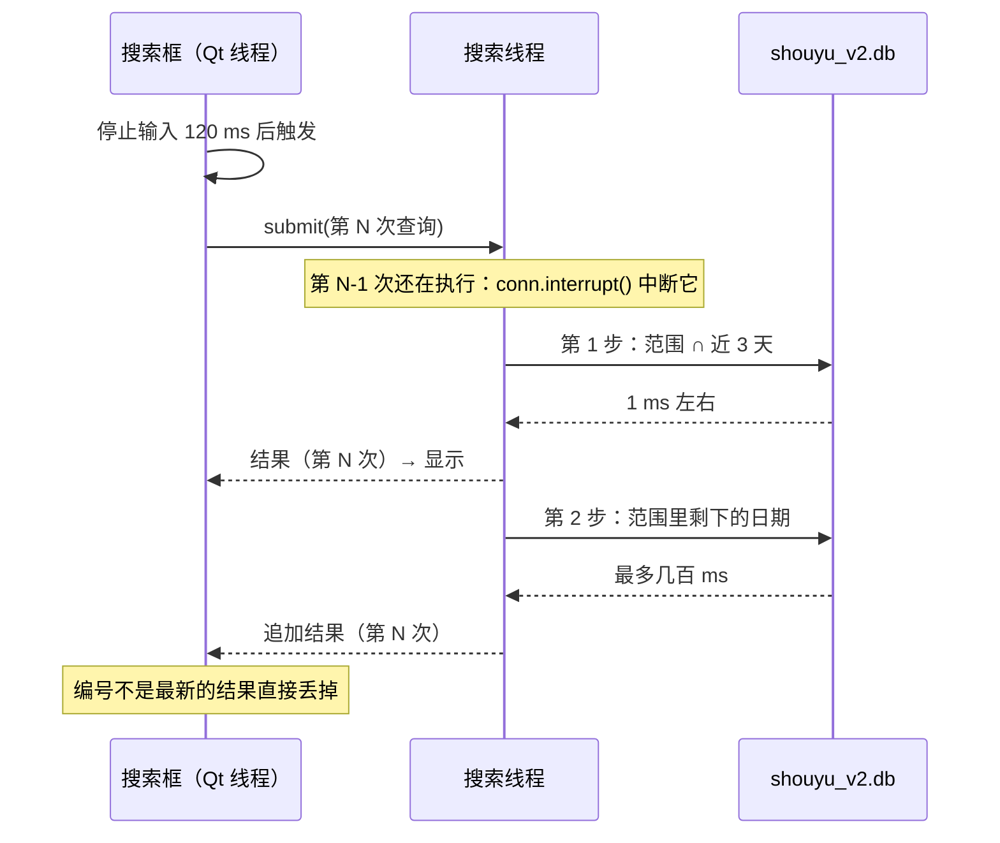
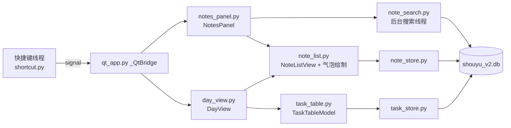
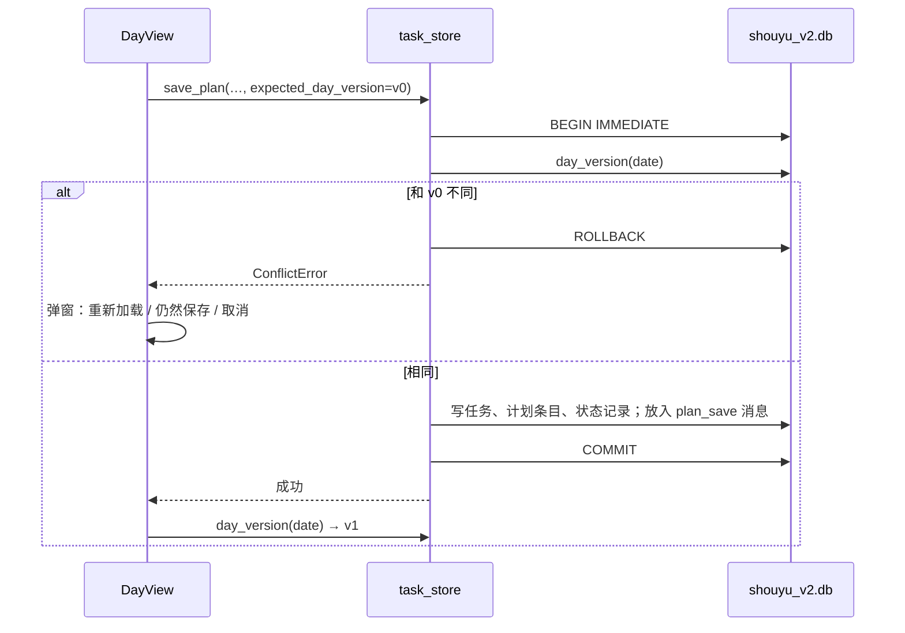

# 设计：记录面板（`alt+/`）和日视图

> 状态：已实现，待审核 ｜ 更新：2026-10-31（实现中和本设计不同的地方见 5.1 节）
>
> 需求：[requirements/retrieval/20261031-01-notes-panel-and-day-view.md](../../requirements/retrieval/20261031-01-notes-panel-and-day-view.md)（以下简称"需求"）。需求第 7 节的问题都按"倾向"定了结论（用户，2026-10-31）。
>
> 依据：当前 v2 工作区的代码，也就是 [design/planning/20261031-01-tasks-to-sqlite.md](../planning/20261031-01-tasks-to-sqlite.md) 实现之后的代码。

## 1. 背景

| 功能 | 现在的代码 | 要改成 |
|---|---|---|
| `alt+/` | `shortcut.py` 的 `show_status()`：`note_store.last()` 取一条，`MessageBox.pop_up_message` 弹出提示；通过 `executor` 队列执行 | 打开记录面板（REC-01） |
| 记录的读取 | `note_store.py` 只有 `save()`、`last()`、`image_bytes()` | 增加分页、搜索、删除、修改（REC-03 到 REC-13） |
| `note` 表 | 没有删除、修改时间；`source` 只允许 `clipboard`、`ocr` | 支持删除、修改、手动添加、Excel 导入（REC-12、REC-13、DAY-08、REC-18） |
| 按天看、改 | 只能在 Excel 里看；晨间仪式窗口只能改今天，历史日期只能"标为已完成" | 日视图（DAY-01 到 DAY-13） |
| 保存任务 | `task_store.save_plan()` 已经支持任意日期；`work_tasks`、`life_tasks` 传 `None` 时不动 Backlog | 增加"不动当天任务、只存 Backlog"，以及保存前的冲突检查（DAY-07、DAY-11） |
| 唤起窗口 | 快捷键线程通过 `QtApp` 的 signal 让 Qt 线程打开窗口（`qt_app.py` 的 `_QtBridge`） | 新增两个 signal |

实测数据（用于第 3.3 节的取舍）：

| 测量 | 结果 |
|---|---|
| 真实 Excel 的副本 | 61 个日期工作表，54 个有"其他"区域；"其他"区域里共 26,317 个文字格子，平均 142 个字；每天中位数 20 个格子，2026-10-20 一天 24,290 个；图片 228 张 |
| 模拟 5 年数据：91,250 条、每条 20 到 600 个字、98 MB | `LIKE` 搜常见字（结果很快凑满 300 条）：1 ms；搜罕见词或搜不到的词（要扫全表）：250 到 415 ms；只搜某一天：1 ms 以内 |
| venv310 的 SQLite | 3.40.1，支持 FTS5 的 trigram 分词 |

## 2. 目标

| 需求 | 设计要点 | 章节 |
|---|---|---|
| REC-01、REC-09、REC-10、REC-16、R-Q9 | 记录面板是一个无边框、置顶的小窗口；键盘操作；失去焦点时隐藏；只建一次，之后显示和隐藏 | 4.2 |
| REC-02、REC-03、REC-05、R-Q10 | 一个列表组件，按"天标题 + 气泡"显示；按页从 SQLite 读取，每页 200 条，一天 2 万条也能滚动 | 4.3 |
| REC-04、REC-06、REC-07 | 搜索在后台线程执行：先查近 3 天，立即显示，再查剩下的范围；新的输入会中断上一次查询 | 3.2、4.2 |
| REC-12、REC-13、DAY-08 | `note` 表增加 `updated_at`、`deleted_at`；删除只做标记 | 3.1 |
| DAY-01 到 DAY-06 | 日视图：日期切换栏 + "当天"页（任务表、番茄表、记录列表）+ "Backlog"页；保存走 `task_store.save_plan()` | 4.5 |
| DAY-11 | 打开某天时记下这一天数据的版本，保存时在同一个事务里比较；不一致就提示 | 3.4、4.5 |
| REC-18、R-Q5 | 在现有的一次性导入后面，再导入"其他"区域的文字 | 4.7 |
| R-Q7 | `kb.ini` 新增 `show_day_view=ctrl+alt+\` | 4.6 |

## 3. 数据

### 3.1 `note` 表的修改（数据库版本 1 → 2）

| 字段 | 修改 | 用途 |
|---|---|---|
| `source` | 允许的值增加 `manual`（日视图里手动加的）和 `excel_import` | DAY-08、REC-18 |
| `source_ref` | 新增，可空；导入时记 `2026-10-29!B35`，唯一索引防止重复导入 | REC-18 |
| `updated_at` | 新增，可空；修改文字时更新 | REC-13 |
| `deleted_at` | 新增，可空；删除时记时间，所有查询都过滤掉 | REC-12 |

SQLite 不能修改已有字段的 `CHECK`，所以要重建这张表。放进 `datastore._MIGRATIONS[2]`，和版本 1 一样在一个事务里执行：

```sql
CREATE TABLE note_v2 (
    id            INTEGER PRIMARY KEY,
    plan_date     TEXT    NOT NULL,
    kind          TEXT    NOT NULL CHECK (kind IN ('text', 'image')),
    text          TEXT    NOT NULL DEFAULT '',
    attachment_id INTEGER REFERENCES attachments(id),
    source        TEXT    NOT NULL CHECK (source IN ('clipboard', 'ocr', 'manual', 'excel_import')),
    source_ref    TEXT,
    excel_column  TEXT    CHECK (excel_column IN ('A', 'B')),
    created_at    TEXT    NOT NULL,
    updated_at    TEXT,
    deleted_at    TEXT
);
INSERT INTO note_v2 (id, plan_date, kind, text, attachment_id, source, excel_column, created_at)
    SELECT id, plan_date, kind, text, attachment_id, source, excel_column, created_at FROM note;
DROP TABLE note;
ALTER TABLE note_v2 RENAME TO note;
-- Keyset paging and day lookups: (plan_date, id) in both directions.
CREATE INDEX IF NOT EXISTS ix_note_date ON note(plan_date, id);
CREATE UNIQUE INDEX IF NOT EXISTS ux_note_source_ref ON note(source, source_ref) WHERE source_ref IS NOT NULL;
```

`id` 保持不变，所以队列里 `clipboard_append` 消息的 `note_id` 仍然有效。没有别的表用外键引用 `note`。

### 3.2 查询

所有查询都带 `deleted_at IS NULL`。

| 用途 | 查询 | 说明 |
|---|---|---|
| 面板打开、往上翻页（REC-03） | `WHERE (plan_date, id) < (:d, :id) ORDER BY plan_date DESC, id DESC LIMIT 200` | 按 `(plan_date, id)` 分页，不用 `OFFSET`，一天 2 万条也一样快；取回后倒序显示 |
| 搜索（REC-04、REC-06、REC-07） | `WHERE plan_date BETWEEN :from AND :to AND text LIKE :p1 ESCAPE '\' [AND text LIKE :p2 ...] ORDER BY plan_date DESC, id DESC LIMIT 300` | 空格分开的每个词一个 `LIKE`；词里的 `\`、`%`、`_` 先转义。`LIKE` 对英文不区分大小写，`handlechat` 能搜到 `HandleChat`（RET-02） |
| 日视图的记录（DAY-08） | `WHERE plan_date = :d ORDER BY id` | |
| `last()`（兼容） | 加上 `deleted_at IS NULL` | |

搜索框为空时是"浏览"，显示图片记录；有关键词时只匹配 `text`，图片记录的 `text` 是空的，不会出现。OCR 记录的 `text` 是识别出来的文字，能搜到。

搜索分两步，满足 REC-04 的时间要求：



搜索线程有自己的数据库连接，只读。WAL 模式下，读不会挡住保存。

### 3.3 考虑过的其他方案

| 方案 | 不用的原因 |
|---|---|
| FTS5 trigram 全文索引 | 至少 3 个字符才能查，满足不了"一两个字就能搜"，1、2 个字仍要用 `LIKE`；索引大约是文字本身的 3 倍大。真实数据的量（每天约 20 条）比模拟数据小得多。先用 `LIKE`，实现后用导入的真实数据测；"全部"超过 0.5 秒时，再给 3 个字符以上的查询加 trigram 索引 |
| 在 Qt 线程里直接查 | 罕见词扫全表要几百毫秒，打字会卡 |
| 打开面板时把所有记录读进内存再过滤 | 导入后有 2.6 万条以上，图片还要另外读；内存和打开速度都不划算 |
| 搜索框放在最上面 | 记录从上到下按时间排、最新的在最下面；搜索框放下面，最新的结果离输入的地方最近，和聊天软件一样 |

### 3.4 `task_store` 的补充

| 修改 | 用途 |
|---|---|
| `PlanSaveRequest.today_tasks` 允许为 `None`：不改这一天的计划，`_soft_delete_dropped()` 把这一天原有的任务都当作还在 | 日视图的 Backlog 页只存 Backlog（DAY-07） |
| `PlanSaveRequest.expected_day_version`、`expected_backlog_version`：可空；不为空时，在 `save_plan()` 的事务里先算当前版本，不一致就抛 `ConflictError`，什么都不写 | DAY-11 |
| `day_version(plan_date)`：读这一天每个计划条目的 `task_id`、`position`、`status` 和任务的 `updated_at`，算一个哈希，加上条数 | 删除、新增、改状态、调整顺序、改名（包括在别的日子改了同一个任务的名字）都能发现 |
| `backlog_version()`：同样的方法，读 `backlog_entry` 的 `task_id`、`position`、`entered_on` 和任务的 `updated_at` | DAY-11。`backlog_entry` 没有 `updated_at` 列，所以不能用 `MAX(updated_at)` |
| `load_day_for_edit(plan_date)`、`load_backlog_for_edit()`：数据和版本号在同一个读事务里取 | 避免"读完数据、取版本号之前被别的窗口改了"漏掉冲突 |
| `load_pomodoros(plan_date)`：返回这一天的番茄，按开始时间排序，带上 `kind` | DAY-03、DAY-09 |

晨间仪式窗口和今日任务面板不传版本号，行为不变（见 7.1 的 D-Q3）。

## 4. 界面和流程

### 4.1 模块关系



### 4.2 记录面板（`shouyu/view/notes_panel.py`）

```
┌───────────────────────────────────────────────┐
│ [今天] [昨天] [前天] [7天] [全部●]    23 条      │  范围（REC-06）
├───────────────────────────────────────────────┤
│ ──────────── 10-29 星期四 ────────────          │
│   09:12  剪贴板                                 │
│   ┌──────────────────────────────┐             │
│   │ medis 账号申请找 xiaokang……   │             │
│   └──────────────────────────────┘             │
│ ──────────── 昨天 10-30 ────────────            │
│   15:20  截图   ┌─────────┐                     │
│                 │ 缩略图   │                     │
│                 └─────────┘                     │
│ ──────────── 今天 ────────────                  │
│   10:52  OCR                                    │
│   ┌──────────────────────────────┐ ← 选中        │
│   │ 数据迁移 SQLite……             │             │
│   └──────────────────────────────┘             │
├───────────────────────────────────────────────┤
│ 🔍 [数据                                    ]   │  搜索框（打开时有焦点）
│ ↑↓ 选择 · Enter 复制 · Space 预览 · Tab 切换范围  │
└───────────────────────────────────────────────┘
```

| 项 | 做法 | 需求 |
|---|---|---|
| 窗口 | `QWidget`，`Qt.Tool | Qt.FramelessWindowHint | Qt.WindowStaysOnTopHint`；560 × 720；显示在鼠标所在屏幕的中间（`QGuiApplication.screenAt(QCursor.pos())`）；`get_or_create()` 只建一次 | REC-01 |
| 打开 | 搜索框清空，范围回到"全部"，加载今天和前面一页，滚到最下面，选中最后一条 | REC-01、REC-03 |
| 关闭 | `Esc`；再按 `alt+/`；窗口失去焦点（`changeEvent` 里的 `ActivationChange`） | REC-01、R-Q9 |
| 往上翻页 | 滚动条接近顶部时，按 3.2 的分页查询再取 200 条，插在最前面，保持当前看到的位置不跳 | REC-03 |
| 键盘 | 焦点一直在搜索框；`↑`、`↓`、`PageUp`、`PageDown` 转给列表；`Enter` 复制；`Space`（搜索框为空时）或 `ctrl+Space` 预览；`Tab`、`shift+Tab`、`alt+1` 到 `alt+5` 切换范围；`ctrl+D` 在日视图中打开；`Delete`（搜索框为空时）删除 | REC-10、REC-14 |
| 复制 | 文字：`QGuiApplication.clipboard().setText()`；图片：`setImage(QImage.fromData(png))`。然后隐藏面板，提示"已复制"。程序写剪贴板不会触发 `ctrl+c` 的全局快捷键 | REC-09 |
| 预览 | 文字：弹出只读的大文本框；图片：按原始大小显示，超过屏幕时缩小 | REC-11 |
| 删除 | 确认后 `note_store.delete(id)`，从列表里移除 | REC-12 |
| 修改 | 右键"修改文字"，只对文字记录；`note_store.update_text()` | REC-13 |
| 右键菜单 | 复制、预览、修改文字、删除、在日视图中查看 | REC-11 到 REC-14 |

### 4.3 气泡列表（`shouyu/view/note_list.py`）

记录面板和日视图共用。

| 部分 | 做法 |
|---|---|
| 数据 | `NoteListModel(QAbstractListModel)`，每一行是"日期标题"或"一条记录"。提供 `prepend_page()`、`append_page()`、`replace_all()`、`remove_note()` |
| 绘制 | `QListView` + `NoteBubbleDelegate(QStyledItemDelegate)`：只画看得见的行，2 万条也不会创建 2 万个控件（R-Q10） |
| 文字 | 气泡里最多显示 6 行，超出的部分用"…"；关键词用 HTML `<span>` 高亮，先对原文做 HTML 转义（REC-08） |
| 图片 | 宽度不超过 240 像素的缩略图；第一次画到这一行时才读取 `attachments` 并缩小；按 `attachment_id` 缓存最近 300 张 |
| 时间 | `created_at` 是 UTC，显示时转成本地时间 `HH:MM`；`excel_import` 的记录没有时间，显示"—" |
| 日期标题 | "今天"、"昨天 10-30"、"前天 10-29"，再往前显示"10-27 星期二"，跨年时显示年份 |

### 4.4 `note_store` 新增的函数

| 函数 | 说明 |
|---|---|
| `page_before(plan_date, note_id, limit=200) -> List[Note]` | 3.2 的分页查询；第一次调用传明天的日期 |
| `search(query: NoteQuery, conn=None) -> List[Note]` | `NoteQuery`：关键词列表、起止日期、`limit`。`conn` 给搜索线程传自己的连接 |
| `list_day(plan_date) -> List[Note]` | 日视图用 |
| `get(note_id) -> Optional[Note]` | |
| `delete(note_id)`、`update_text(note_id, text)` | 只改 SQLite，不同步 Excel（R-Q3） |
| `add_manual(plan_date, text) -> Note` | `source='manual'`，不同步 Excel（D-Q2） |

`Note` 增加 `updated_at` 字段。`save()` 的行为不变。

`shouyu/service/note_search.py`：`NoteSearcher` 持有一个后台线程和一个只读连接；`submit(query, generation, callback)`；有新的查询时先调用 `conn.interrupt()`，被中断的查询抛出的 `sqlite3.OperationalError` 不当作错误。面板通过 Qt signal 把回调转回 Qt 线程。

### 4.5 日视图（`shouyu/view/day_view.py`）

```
┌──────────────────────────────────────────────────────────────────────┐
│ ◀  2026-10-29 星期四  ▶   [今天] [选日期…]          ● 未保存  [保存 Ctrl+S] │
├──────────────────────────────────────────────────────────────────────┤
│ [当天] [Backlog]                                                       │
├──────────────────────────────────────────┬───────────────────────────┤
│ 任务                       状态  优先级 时长 类别 反思 │ 记录（12）                  │
│ feedback的几个问题跟踪一下   待办   P2    30  工作      │   09:12 剪贴板 ┌────────┐   │
│ 数据迁移                    进行中 P1    240 工作      │               │……      │   │
│ …                                                    │               └────────┘   │
├──────────────────────────────────────────┤   ……                       │
│ 番茄（只读）                                         │                            │
│ 09:00–09:50  50 分  数据迁移   深度                   │ [+ 加一条记录……          ] │
│ 10:00–10:25  25 分  数据迁移   经典  提前结束          │                            │
└──────────────────────────────────────────┴───────────────────────────┘
```

| 项 | 做法 | 需求 |
|---|---|---|
| 窗口 | 普通窗口（有标题栏，可以和其他窗口并排）；第一次打开时最大化在鼠标所在屏幕；`get_or_create()` | DAY-01 |
| 切换日期 | `◀`、`▶`、`ctrl+PageUp`、`ctrl+PageDown`、"今天"、"选日期…"（`QCalendarWidget` 弹出）。有未保存的改动时先问"保存、不保存、取消" | DAY-02 |
| 读取 | `task_store.load_today(date)`、`load_pomodoros(date)`、`note_store.list_day(date)`、`day_version(date)`，一次只读这一天 | DAY-03、DAY-13 |
| 任务表 | `QTableView` + `TaskTableModel`；列：任务、状态、优先级、预估时长、工作或生活、反思。状态、优先级、类别用 `QComboBox` 编辑；时长用 `QSpinBox`（分钟） | DAY-04 |
| 行操作 | `ctrl+Enter` 新增一行；`Delete` 删除（任务名不为空时确认）；`alt+↑`、`alt+↓` 移动；`ctrl+Z`、`ctrl+Y` 撤销和重做（和晨间仪式窗口一样，保存整张表的快照） | DAY-04 |
| 进行中只有一个 | 把一行改成"进行中"时，其他"进行中"的行改成"待办"，和 `habit_dialog.py` 的 `_set_status()` 一样 | DAY-05 |
| 完成后的反思 | 日视图不弹反思提示，直接在"反思"列里写 | 见 D-Q4 |
| 保存 | `ctrl+S`、保存按钮、关闭时提示。调用 `save_plan(PlanSaveRequest(plan_date=日期, today_tasks=表里的任务, original_in_progress=…, expected_day_version=打开时的版本))`；成功后更新版本号。日期是今天时，再通知番茄钟刷新当前任务名，和晨间仪式窗口一样 | DAY-05、DAY-06、DAY-12 |
| 冲突 | 收到 `ConflictError`：弹窗"这一天的任务已经在别的窗口改过"，按钮"重新加载"（丢掉日视图里的改动）、"仍然保存"（不带版本号再存一次）、"取消" | DAY-11 |
| 番茄表 | 只读 `QTableView`；规划番茄（`kind='planning'`）灰色显示，不计数 | DAY-09 |
| 记录区 | `NoteListView` 显示这一天；下面的输入框回车后调用 `note_store.add_manual(date, text)` | DAY-08 |
| Backlog 页 | 两张表（工作、生活），和任务表用同一个 model，列：任务、优先级、预估时长、已搁置天数（只读）；可以在两张表之间移动。保存时 `today_tasks=None`，带 `expected_backlog_version` | DAY-07 |
| 复制格子 | 选中区域按 `ctrl+C`，用制表符和换行拼成文字放进剪贴板 | DAY-10 |

日视图修改历史日期的任务名，会同时改变今天和 Backlog 里同一个任务的名字，因为任务有身份（需求 T-Q5 的结论 A）。

保存流程：



### 4.6 快捷键和唤起

| 项 | 修改 |
|---|---|
| `kb.ini` | `show_status=alt+/` 不改名字，注释改为"打开记录面板"；新增 `show_day_view=ctrl+alt+\` |
| `shortcut.py` | `show_status()` 改为调用 `QtApp.toggle_notes_panel()`；注册时 `is_in_queue=False`，和其他打开窗口的快捷键一样，不在 `executor` 队列里等。新增 `show_day_view()` |
| `qt_app.py` | 新增 `toggle_notes_panel_signal = Signal()`、`show_day_view_signal = Signal(str)`（参数是日期，空字符串表示今天），以及对应的槽函数和 `QtApp` 类方法 |
| `tray.py` | 托盘菜单增加"记录面板""日视图" |
| 快捷键冲突 | `keyboard` 库已经能识别 `ctrl+\`，`ctrl+alt+\` 要在你的电脑和输入法下实测；不行就改用 `ctrl+alt+d`（R-Q7） |

### 4.7 导入 Excel 历史文字（REC-18，取决于 R-Q5）

| 项 | 做法 |
|---|---|
| 时机 | `task_import.start_in_background()` 的同一个后台线程，在任务导入之后执行；用新的 meta `excel_notes_import_finished_at` 记录完成，所以已经做过任务导入的数据库也会执行一次 |
| 解析 | 每个日期工作表：找 A 列为 `other` 的标题行（`PlanService._other_header_row()`）；标题行以下，按行、再从左到右，每个非空格子一条记录（R-Q10）。数字、日期等转成文字。C 列及以后的格子也导入（真实数据里有 31 格手写的文字），`excel_column` 为空。以 🍅 开头的格子是番茄记录，任务导入时已经作为番茄导入，这里跳过（真实数据里有 15 个） |
| 没有标题行的工作表 | 跳过，在日志里记下有哪些（真实数据里 7 个） |
| 图片 | 不导入（R-Q5 的 A），留在 Excel |
| 写入 | 先全部解析完，再在一个事务里 `INSERT OR IGNORE`；`source='excel_import'`，`source_ref='日期!B35'`，`excel_column` 是格子所在的列；`created_at` 记那一天本地 0 点对应的 UTC 时间。不放同步消息（Excel 里已经有了） |
| 切换当天 | 开始用 v2 的那一天（`excel_import_finished_at` 的本地日期），Excel 的"其他"区域里，既有 v1 当天早些时候存的，也有 v2 同步过去的。这一天只导入文字和 v2 里当天已有记录都不相同的格子，避免重复 |
| 导入期间 | 面板照常使用，导入完成前搜不到历史文字 |

### 4.8 用现成的 SQLite 工具查看数据

需求 3.2 节：通用工具不作为日常编辑入口。核对数据时推荐 [DB Browser for SQLite](https://sqlitebrowser.org/)（开源，有免安装版），用只读方式打开 `shouyu_v2.db`：`DB Browser for SQLite.exe -R shouyu_v2.db`。

不建议用它改数据：直接改表会绕过 `task_store` 的规则（状态记录、同一天只有一个进行中、软删除、同步到 Excel），程序运行时写入还会和程序抢写锁。

## 5. 具体改动

| 文件 | 改动 |
|---|---|
| `shouyu/service/datastore.py` | `_MIGRATIONS[2]`：3.1 的重建语句 |
| `shouyu/service/note_store.py` | `Note.updated_at`；4.4 的新函数；`last()` 过滤已删除的记录 |
| `shouyu/service/note_search.py`（新） | `NoteQuery`、`NoteSearcher`（后台线程、中断、两步查询） |
| `shouyu/service/task_store.py` | 3.4 的修改：`today_tasks` 可为 `None`、版本号、`ConflictError`、`day_version()`、`backlog_version()`、`load_pomodoros()` |
| `shouyu/service/task_import.py` | 4.7 的文字导入；新的 meta 键 |
| `shouyu/view/note_list.py`（新） | `NoteListModel`、`NoteBubbleDelegate`、`NoteListView`、预览窗口 |
| `shouyu/view/notes_panel.py`（新） | `NotesPanel` |
| `shouyu/view/task_table.py`（新） | `TaskTableModel` 和各列的编辑器，日视图的当天页和 Backlog 页共用 |
| `shouyu/view/day_view.py`（新） | `DayView` |
| `shouyu/view/qt_app.py` | 两个新的 signal 和槽函数 |
| `shouyu/action/shortcut.py` | `show_status()` 改为打开面板；新增 `show_day_view()`；注册快捷键 |
| `shouyu/view/tray.py` | 两个菜单项 |
| `kb.ini` | `show_status` 的注释；`show_day_view=ctrl+alt+\` |
| `shouyu/service/dispatch.py` | `plan_save` 消息的 `tasks` 为 `None` 时不改那一天的工作表（只存 Backlog 时用） |
| `test/test_note_store.py` | `show_status` 的测试改为检查"打开面板" |
| `test/test_excel_mirror.py` | 只存 Backlog 时，Excel 里那一天的计划区不变 |
| `test/` 新增 | `test_note_query.py`（分页、搜索、转义、多个词、删除、修改、迁移，以及搜索线程的中断、两步查询、过时结果丢弃）、`test_note_import.py`（文字导入、重复导入、切换当天去重）、`test_day_version.py`（版本号和冲突）、`test_notes_panel.py` 和 `test_day_view.py`（离屏界面测试） |
| `README.md` | 更新日志 |

实现顺序：

| 步骤 | 内容 | 完成后能用 |
|---|---|---|
| 1 | 迁移、`note_store` 的查询、搜索线程、气泡列表、记录面板、`alt+/` | 记录面板的 P0 需求 |
| 2 | 历史文字导入（R-Q5 为 A 时） | 搜得到以前的记录 |
| 3 | `task_store` 的补充、任务表、日视图的当天页、`ctrl+alt+\` | 日视图的 P0 需求 |
| 4 | Backlog 页、复制格子、P1 和 P2 的其余需求 | 全部 |

### 5.1 实现中和设计不同的地方（2026-10-31）

| 地方 | 实际做法 | 原因 |
|---|---|---|
| 3.4 的版本号 | 用条目内容算哈希，不用 `MAX(updated_at)` | `backlog_entry` 没有 `updated_at`，调整 Backlog 顺序时 `MAX` 不变 |
| 3.4 只存 Backlog | `dispatch.py` 也要改：`tasks` 为 `None` 时不写那一天的工作表 | 否则 Excel 里那一天的计划区会被清空 |
| 4.7 导入的范围 | C 列及以后也导入；🍅 开头的格子跳过 | 见 4.7 |
| 4.5 的记录区 | 一天的记录分页加载（每页 200 条），往上滚动加载更早的；新增 `note_store.day_page()`、`count_day()` | 真实数据里 10-20 有 24,290 条，一次全读要 1 秒，分页后切到这一天 0.09 秒 |
| 4.2 的记录面板 | 记录不满一屏时，气泡贴着搜索框（像聊天软件），不是从顶部排起 | REC-02、REC-05：越新的越靠近搜索框 |
| D-Q5 | 程序启动 3 秒后预先建好记录面板 | 第一次建窗口约 0.25 秒，加上第一次打开 0.1 秒会超过 REC-16 的 0.3 秒 |
| 4.5 的表格按键 | `ctrl+Enter`、`Delete`、`alt+↑↓`、`ctrl+C` 在表格自己的按键处理里做，不用 `QShortcut` | 编辑格子时按键先给编辑框；也便于离屏测试 |
| 测试文件 | 搜索线程的测试放在 `test_note_query.py`，没有单独的 `test_note_search.py` | 共用同一组测试数据 |

## 6. 验证

| 需求 | 方法 |
|---|---|
| REC-01、REC-09、REC-10 | 在浏览器、Cursor、Excel 里各按一次 `alt+/`，只用键盘完成"搜索、选择、复制、粘贴到记事本" |
| REC-02、REC-03、REC-05 | 在 3 天里各存几条（用临时数据库），检查分组、顺序、往上翻页 |
| REC-04、REC-16 | 导入真实数据的副本后，记录面板打开时间、搜 1 个字、2 个字、搜不到的词的耗时；再用 5 年模拟数据测一次 |
| REC-12、REC-13 | 删除、修改后，面板、日视图、搜索都检查一遍；Excel 里原有的那一条不变 |
| REC-15、DAY-12 | 把 Excel 改名后逐项操作 |
| REC-18 | 真实 Excel 的副本：抽查 3 天的条数和内容；再导入一次，数量不变；切换当天没有重复 |
| DAY-03 | 选 3 个历史日期，和 Excel 副本的工作表对比 |
| DAY-04 到 DAY-06 | 改今天和 10-29 的任务，保存后在晨间仪式窗口里看；查 `task_status_log` |
| DAY-11 | 日视图打开今天；在今日任务面板改一个任务并保存；回到日视图保存，应该看到冲突提示，三个按钮各试一次 |
| DAY-13 | 真实数据下，打开时间、连续翻 30 天的时间 |
| 快捷键 | `ctrl+alt+\` 在中文输入法、英文输入法下各试一次 |

## 7. 待确认项

### 7.1 设计上的取舍

| # | 问题 | 倾向 |
|---|---|---|
| D-Q1 | 搜索先用 `LIKE`，不建全文索引 | 是。用真实数据测过再决定要不要加 trigram 索引（3.3） |
| D-Q2 | 日视图里手动加的记录要不要同步到 Excel？ | 不同步。和 R-Q3 一致：在 v2 里新增、修改、删除的记录只在 SQLite；而且历史日期的"其他"区域位置不好确定 |
| D-Q3 | 晨间仪式窗口和今日任务面板保存时，要不要也检查冲突？ | 这次不加。需求 DAY-11 只要求日视图检查；另外两个窗口加检查是很小的改动，但会改变它们现在的行为，需要你同意 |
| D-Q4 | 日视图里把任务改成"完成"时，要不要像晨间仪式窗口一样弹出反思提示？ | 不弹。日视图主要用来补改和整理，弹窗会打断连续编辑；反思可以直接在"反思"列写 |
| D-Q5 | 记录面板是不是常驻内存（第一次打开后只隐藏不销毁）？ | 是。第二次打开不用重建窗口和缩略图缓存，满足 REC-16 |

结论：D-Q1～D-Q5 都按倾向（用户，2026-10-31）。需求的 R-Q1～R-Q10 也都按倾向，所以 7.2 节的修改都不需要做。

### 7.2 依赖需求结论的地方

| 需求问题 | 结论不同时要改的地方 |
|---|---|
| R-Q1 选 B（任务也一起搜） | 3.2 的搜索要合并 `task` 表；气泡要区分"记录"和"任务"；回车的行为要重新定义 |
| R-Q2 选 B（保留原来的提示） | 4.6：`show_status` 保持现状，面板用新的快捷键 |
| R-Q3 选 B（删除、修改同步到 Excel） | 需要给 Excel 里的每一条记录找到对应的格子；现在 `clipboard_append` 只记了 `note_id`，没有记写到了哪个格子，要先改同步的代码 |
| R-Q4 选 B（自由格子） | 4.5 的日视图改用网页表格组件（比如 Univer），还要新建表来存自由格子里的内容，工作量大很多 |
| R-Q5 选 B（不导入） | 去掉 4.7 和实现顺序的第 2 步 |
| R-Q7 选 C | `kb.ini` 里 `open_excel` 改为 `ctrl+alt+\`，`show_day_view` 改为 `ctrl+\` |
| R-Q9 选 B | 4.2 去掉"失去焦点时隐藏"，窗口改为普通置顶窗口 |
| R-Q10 选 B | 4.7 的解析要定义"哪些格子算同一次保存"，目前没有可靠的依据 |
