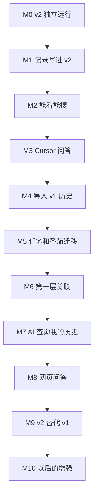

# v2 路线图

> 状态：草稿 ｜ 更新：2026-10-31
>
> 需求总表在 [requirements/](requirements/)，本文只安排做的顺序。需求编号的含义以需求文档为准。

## 1. 原则

| 原则 | 做法 |
|---|---|
| 小步走 | 每个里程碑只做一小块，做完就能用，或者至少能验证 |
| 一次只细化一个 | 前一个里程碑完成后，才开始细化下一个里程碑的需求 |
| 先需求后设计 | 每个里程碑都按第 2 节的步骤走，需求没有定稿就不开始设计 |
| v1 不停 | v2 在替代 v1 之前（M9），v1 照常日常使用 |
| 问题按需确认 | 每个待确认问题只需要在用到它的里程碑开始前确认，不必一次全部定下来 |

## 2. 每个里程碑的步骤

| 步骤 | 产出 |
|---|---|
| 细化需求 | `requirements/<模块>/<日期>-<序号>-<主题>.md`：具体场景、逐条验收标准、明确不做什么、确认相关的待确认问题 |
| 评审定稿 | 细化文档的状态改为"已定稿" |
| 设计 | `design/<模块>/<日期>-<序号>-<主题>.md`，每个设计决策都注明对应的需求编号 |
| 实现 | 代码和测试 |
| 验收 | 逐条对照细化文档里的验收标准 |
| 更新现状并打 tag | 更新需求总表的"现状"列、继承清单的"v2 现状"列和本文第 4 节；打 tag `v2.0.0-alpha.N`（版本号规则待 Q11 确认） |

## 3. 里程碑总览

| 里程碑 | 做完之后能做什么 | 包含的需求 | 开始前要确认的问题 | 细化文档放在 |
|---|---|---|---|---|
| M0 v2 独立运行 | v2 能和 v1 装在同一台电脑上，有自己的数据库、日志、配置，不碰 v1 的数据 | STO-02、NFR-11、INH-26、INH-30、INH-32 | Q2、Q11 | `requirements/overview/` |
| M1 记录写进 v2 | 快捷键保存的文字、图片、OCR 结果直接存进 v2 自己的数据库，带上时间、前台程序、窗口标题、网址；Excel 打开与否都不影响 | STO-01、STO-04、CAP-01、CAP-02、CAP-03（不含任务和番茄）、CAP-10、CAP-11、NFR-03、INH-01、INH-02、INH-03、INH-06；STO-05 从这里开始逐步完成 | Q4、Q7 | `requirements/capture/` |
| M2 能看能搜 | 一个快捷键打开 v2 界面，按天看时间线，关键词搜索，按时间、来源、类别筛选；数据能备份和恢复 | RET-01、RET-02、RET-03（不含项目）、RET-05（不含关联）、RET-06、RET-07、NFR-05、STO-10、STO-11、INH-04、INH-27、INH-28 | 无 | `requirements/retrieval/` |
| M3 Cursor 问答 | Cursor 的问答自动、持续地保存到 v2，历史会话一次性导入，可以搜索，可以按项目和文件查找 | CAP-04、CAP-05、CAP-06、CAP-09、STO-03、STO-07、NFR-04、ASC-04（项目和文件部分）、RET-03（项目筛选） | Q9、Q10 | `requirements/capture/` |
| M4 导入 v1 历史 | v1 Excel 里的历史记录进入 v2，可以搜索 | STO-08、STO-09 | Q1 | `requirements/storage/` |
| M5 任务和番茄迁移 | v2 里有今日任务、Backlog、晨间仪式、番茄钟，任务和番茄本身也成为记录 | INH-07 到 INH-25、CAP-08、CAP-03（任务和番茄部分） | Q6（任务和番茄部分） | 新建 `requirements/planning/` |
| M6 第一层关联 | 看一条记录时，能看到同一时段、同一任务、同一项目和文件的其他记录，以及关联的原因 | ASC-01、ASC-02、ASC-03、ASC-04（分支和提交部分）、ASC-08、ASC-10、RET-05（关联部分）、RET-08 | 无 | `requirements/association/` |
| M7 AI 查询我的历史 | 在 Cursor 里问问题时，AI 能先查我的历史；发往外部的内容受控 | RET-10、RET-11、NFR-09、CAP-13 | Q5、Q8 | `requirements/retrieval/` |
| M8 网页问答 | Qwen、元宝的问答能保存到 v2；以后新增来源更容易 | CAP-07、CAP-12 | Q3 | `requirements/capture/` |
| M9 v2 替代 v1 | v2 覆盖日常使用的全部功能，v1 停用 | INH 中剩下的项、NFR-06、NFR-12 | Q6（剩余部分）、Q12 | `requirements/overview/` |
| M10 以后的增强 | 按意思搜索和关联、共同内容关联、手工关联、联想、提炼、导出、手机查看等 | ASC-05、ASC-06、ASC-07、ASC-09、RET-04、RET-09、RET-12、RET-13、STO-06、STO-12 | Q4 的结论 | 到时再定，可能拆成多个里程碑 |

以下需求不属于某一个里程碑，每个里程碑都要满足：NFR-01、NFR-02、NFR-07、NFR-08、NFR-10、NFR-13。

### 排序理由

| 顺序 | 理由 |
|---|---|
| M0 放在最前 | 现在 v2 分支的 `kb.ini` 指向 v1 的数据库、日志和 Excel，直接运行 v2 会改到 v1 的数据 |
| M1、M2 早于 M3 | 先用最简单的来源（剪贴板）把"存进去、看得到、搜得到"跑通，再接入数据量大的 Cursor 问答 |
| M3 早于 M5 | 集中保存 AI 问答是这次的出发点，价值最高；任务和番茄在 v1 里还能正常用，不急着迁移 |
| M5 早于 M6 | 按任务关联（ASC-02）需要知道"当时正在做哪个任务"，这要等任务和番茄迁移到 v2 后才有 |
| M8 放在后面 | 网页采集依赖网页内部结构，最容易失效，放在架构稳定之后 |

## 4. 当前进度

| 里程碑 | 状态 | 细化文档 | 设计文档 | tag |
|---|---|---|---|---|
| M0 | 未开始 | | | |
| M1 | 未开始 | | | |
| M2 | 未开始 | | | |
| M3 | 未开始 | | | |
| M4 | 未开始 | | | |
| M5 | 未开始 | | | |
| M6 | 未开始 | | | |
| M7 | 未开始 | | | |
| M8 | 未开始 | | | |
| M9 | 未开始 | | | |
| M10 | 未开始 | | | |

状态的取值：未开始、需求细化中、需求已定稿、设计中、实现中、已完成。

**下一步**：确认 Q2（v1 和 v2 会不会同时运行）和 Q11（版本号），然后细化 M0 的需求。
